# FinSight — App Flow

How the app behaves as of **2026-10-30**: the screens and routes, the
authentication flows, how the app decides where to go, and where data
flows. The Mermaid diagrams render on GitHub and in VS Code's Markdown
preview. See [DECISIONS.md](DECISIONS.md) for the reasons behind each choice.

---

## 1. Architecture

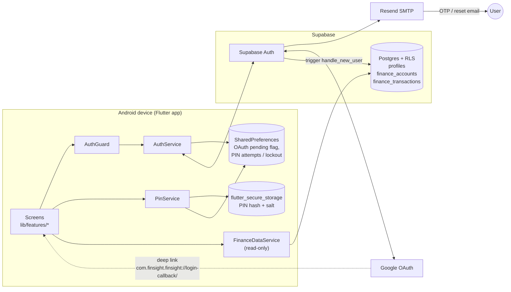

**Startup (`main.dart`):**

1. `AuthService.initialize()` reads the build-time defines `SUPABASE_URL`,
   `SUPABASE_PUBLISHABLE_KEY` and `AUTH_REDIRECT_URL`. If they are missing,
   Supabase is not initialised and every auth call fails closed.
2. `FinSightApp` subscribes to `onAuthStateChange` (the global auth listener
   in section 4).
3. The app opens at `/` (Splash).

---

## 2. Route map

| Route | Screen | Guarded | Arguments |
|---|---|---|---|
| `/` | SplashScreen | – | – |
| `/onboarding` | OnboardingScreen (3 slides) | – | – |
| `/sign-up` | SignUpScreen | – | – |
| `/login` | LoginScreen | – | – |
| `/verification` | VerificationScreen | – | `String email` |
| `/sign-up-success` | SignUpSuccessScreen | – | – |
| `/forgot-password` | ForgotPasswordScreen | – | – |
| `/email-sent` | EmailSentScreen | – | `String email` |
| `/reset-password` | ResetPasswordScreen | – | – |
| `/setup-account` | SetupAccountScreen | ✅ | – |
| `/setup-pin` | SetupPinScreen | ✅ | – |
| `/unlock-pin` | EnterPinScreen | ✅ | – |
| `/add-account` | AddAccountScreen | ✅ | – |
| `/home` | HomeScreen | ✅ | – |
| *unknown route* | SplashScreen | – | – |

A guarded screen shows a spinner first. If `AuthService.isAuthenticated` is
false, it replaces the whole navigation stack with `/onboarding`.

---

## 3. Full screen flow

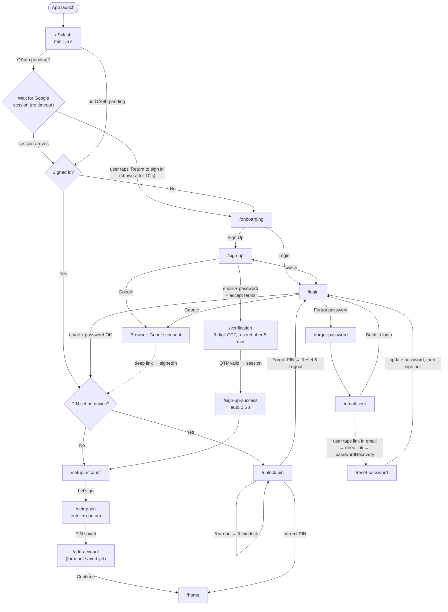

---

## 4. Global auth listener (`main.dart`)

These auth events run no matter which screen is open:

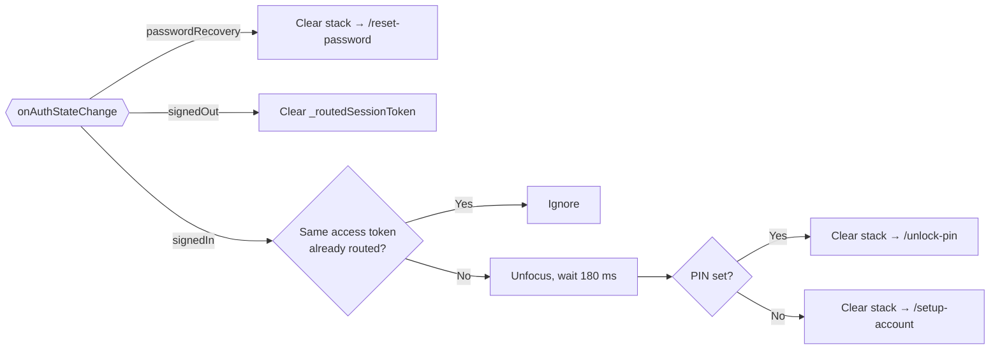

> The Login and Verification screens also navigate themselves after a
> successful sign-in, so both they and this listener can push a route.
> See R-03 in DECISIONS.md.

---

## 5. Sequence diagrams

### 5.1 Email sign-up

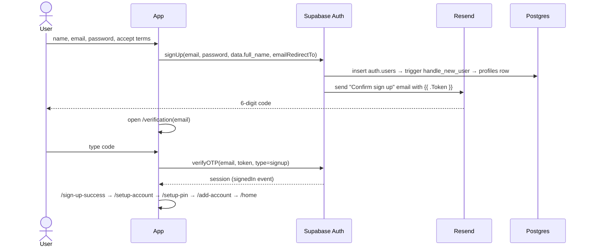

### 5.2 Email login

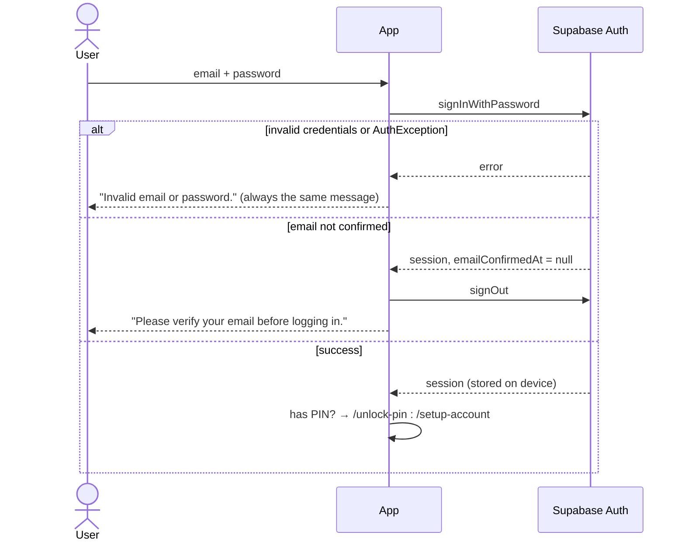

### 5.3 Google sign-in (cold start after browser return)

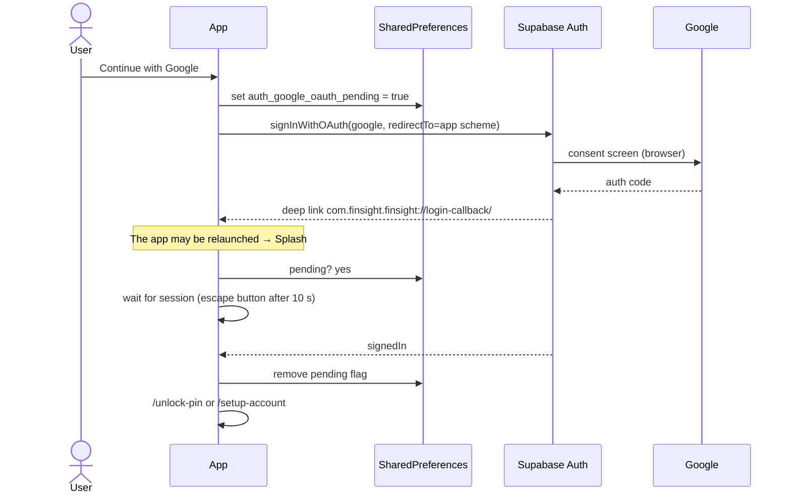

### 5.4 Password recovery

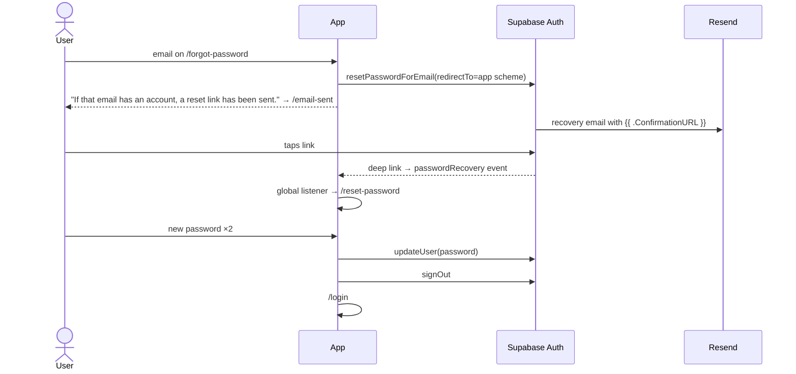

### 5.5 PIN setup and unlock

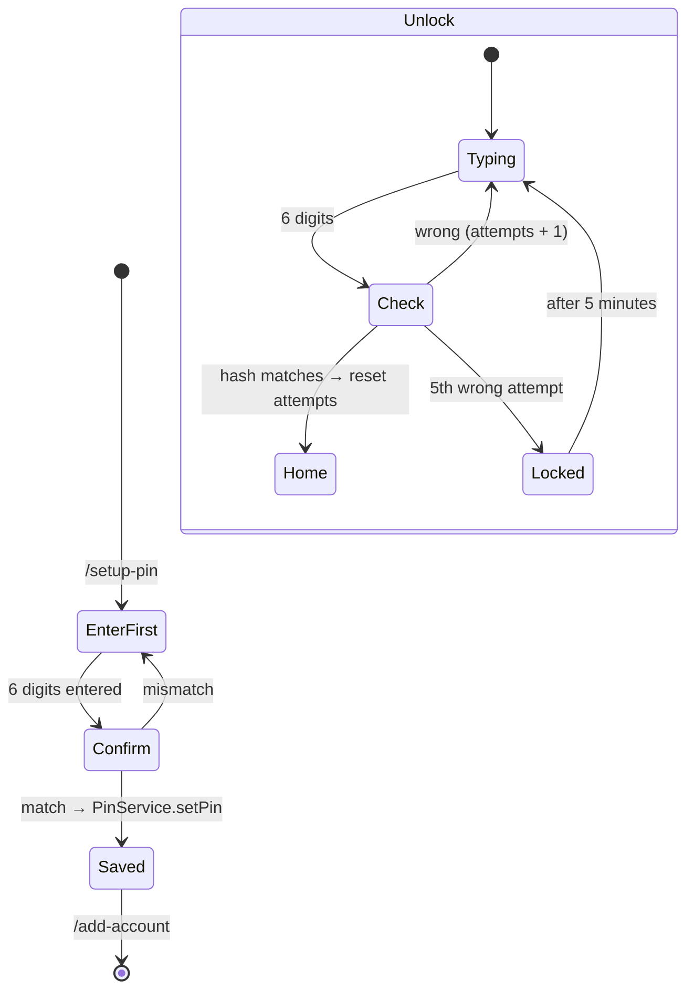

PIN storage: `sha256("<base64url 32-byte salt>:<pin>")`. The hash and salt
are kept in `flutter_secure_storage` (`user_security_pin_hash_v2`,
`user_security_pin_salt_v2`). The attempt count and lock time are kept in
SharedPreferences.

---

## 6. Data flow (Home dashboard)

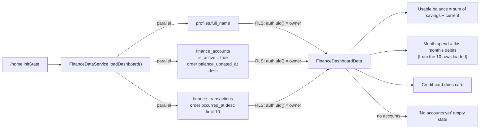

> Month spend only adds up the 10 most recent transactions, so it is too low
> once a month has more than 10.
>
> The app has **no write path** yet. Rows have to be inserted on the server
> (for example in the Supabase dashboard) before Home shows anything except
> the empty state.

---

## 7. Database

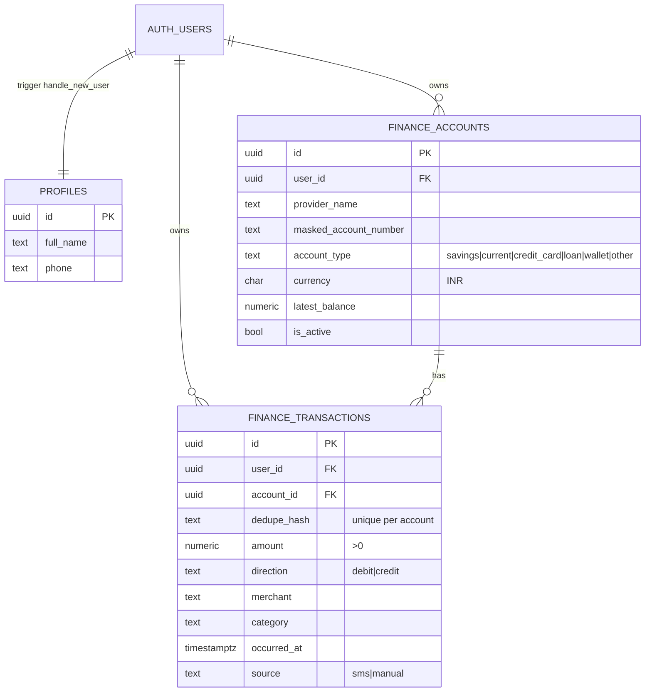

Migrations, applied in this order:

1. `20261026_001_finance_foundation.sql`: tables, indexes, `updated_at`
   triggers, `handle_new_user`, RLS read policies.
2. `20261029_002_remove_bank_connect.sql`: removes the Account
   Aggregator/Setu tables, column and rows (`source = 'aa'`).

---

## 8. Planned flow not yet built (Phase 1 from the design doc)

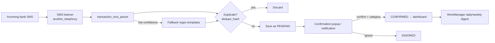

What has to be built or decided first (details in DECISIONS.md):

- SMS and notification permissions in `AndroidManifest.xml`. Today the
  manifest only has `INTERNET`.
- A `status` column (pending / confirmed / ignored) on
  `finance_transactions`, or in a local Drift table.
- Write access: either RLS INSERT/UPDATE policies or an RPC (P-02).
- Where the data is stored: local, cloud, or both (P-01).
- Turn Add Account into a real form that saves to `finance_accounts`.
