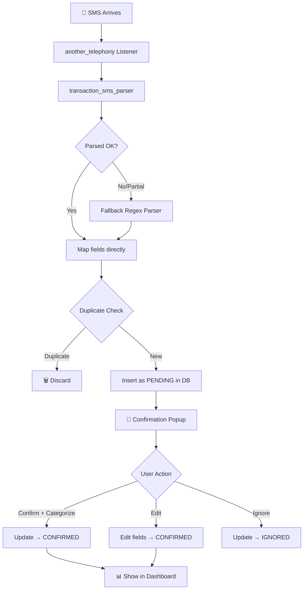

# 🚀 FinSight - Complete Phase-Wise Implementation Plan

> **Automated Personal Finance Monitoring & Spending Insight**
> Flutter (Android-first) | SMS Parsing | Local-first Architecture

---

## 📋 Overview

| Phase | Name | Focus | Backend Needed? |
|-------|------|-------|-----------------|
| **Phase 1** | SMS Parsing & Expense Tracking | Capture, parse, categorize transactions | ❌ No (fully on-device) |
| **Phase 2** | Spending Insights | Analytics, budgets, charts, anomaly detection | ❌ No (computation over Phase 1 data) |
| **Phase 3** | Ecosystem Integration | Splitwise, Affordability check, Wishlist | ⚠️ Thin serverless (OAuth only) |

---

## 🏗️ Phase 1 — SMS Parsing & Expense Tracking

### Step 1.1: Project Setup & Directory Structure

```
finsight/
├── android/                          # Auto-generated Android config
├── lib/
│   ├── main.dart                     # App entry point
│   ├── app.dart                      # MaterialApp, theme, routing
│   │
│   ├── core/                         # Shared foundation
│   │   ├── theme/
│   │   │   ├── app_theme.dart        # ThemeData (colors, text styles)
│   │   │   └── app_colors.dart       # Color constants
│   │   ├── constants/
│   │   │   └── app_constants.dart    # Timeouts, durations, defaults
│   │   ├── utils/
│   │   │   ├── date_utils.dart       # Date formatting helpers
│   │   │   ├── currency_utils.dart   # ₹ formatting
│   │   │   └── string_utils.dart
│   │   └── extensions/               # Dart extensions
│   │       └── context_extensions.dart
│   │
│   ├── data/                         # Data layer
│   │   ├── database/
│   │   │   ├── app_database.dart     # Drift database definition
│   │   │   ├── app_database.g.dart   # Generated code
│   │   │   ├── tables/
│   │   │   │   ├── transactions.dart # Transaction table
│   │   │   │   ├── accounts.dart     # Account table
│   │   │   │   └── categories.dart   # Category table
│   │   │   └── daos/
│   │   │       ├── transaction_dao.dart
│   │   │       ├── account_dao.dart
│   │   │       └── category_dao.dart
│   │   ├── models/
│   │   │   ├── transaction_model.dart
│   │   │   ├── account_model.dart
│   │   │   └── category_model.dart
│   │   └── repositories/
│   │       ├── transaction_repository.dart
│   │       ├── account_repository.dart
│   │       └── category_repository.dart
│   │
│   ├── services/                     # Business logic services
│   │   ├── sms/
│   │   │   ├── sms_listener_service.dart     # Real-time SMS listener
│   │   │   ├── sms_parser_service.dart       # Parser orchestrator
│   │   │   ├── fallback_parser.dart          # Custom regex fallback
│   │   │   └── templates/
│   │   │       └── bank_templates.json       # Fallback regex templates
│   │   ├── duplicate_detector.dart           # Dedup logic
│   │   ├── notification_service.dart         # Local notifications
│   │   ├── backup_service.dart               # CSV export + encrypted backup
│   │   └── workmanager_service.dart          # Background jobs
│   │
│   ├── features/                     # Feature-based UI modules
│   │   ├── home/
│   │   │   ├── home_screen.dart
│   │   │   └── widgets/
│   │   │       ├── transaction_card.dart
│   │   │       ├── daily_summary_card.dart
│   │   │       └── quick_stats_bar.dart
│   │   ├── transactions/
│   │   │   ├── transaction_list_screen.dart
│   │   │   ├── transaction_detail_screen.dart
│   │   │   ├── manual_entry_screen.dart
│   │   │   └── widgets/
│   │   │       ├── transaction_tile.dart
│   │   │       └── filter_bar.dart
│   │   ├── categories/
│   │   │   ├── category_screen.dart
│   │   │   └── widgets/
│   │   │       └── category_chip.dart
│   │   ├── accounts/
│   │   │   ├── accounts_screen.dart
│   │   │   └── widgets/
│   │   │       └── account_card.dart
│   │   ├── confirmation/
│   │   │   └── confirmation_popup.dart       # Post-parse confirmation UI
│   │   └── settings/
│   │       ├── settings_screen.dart
│   │       └── backup_export_screen.dart
│   │
│   └── providers/                    # State management (Riverpod)
│       ├── transaction_provider.dart
│       ├── account_provider.dart
│       ├── category_provider.dart
│       └── sms_provider.dart
│
├── assets/
│   ├── templates/
│   │   └── bank_templates.json       # Fallback parser templates
│   └── icons/                        # Custom category icons
│
├── test/                             # Unit + widget tests
│   ├── services/
│   │   ├── sms_parser_test.dart
│   │   └── duplicate_detector_test.dart
│   └── data/
│       └── transaction_dao_test.dart
│
└── pubspec.yaml
```

### Step 1.2: Dependencies (`pubspec.yaml`)

```yaml
dependencies:
  flutter:
    sdk: flutter
  
  # SMS
  another_telephony: ^2.0.0         # SMS read/listen
  transaction_sms_parser: ^0.0.1    # Base SMS parser (vendor into repo)
  
  # Database
  drift: ^2.x.x                     # Type-safe SQLite
  sqlite3_flutter_libs: ^0.5.x      # SQLite bindings
  
  # State Management
  flutter_riverpod: ^2.x.x
  
  # UI
  flutter_overlay_window: ^0.x.x    # System overlay popup
  flutter_local_notifications: ^x.x.x
  
  # Permissions
  permission_handler: ^11.x.x
  
  # Background
  workmanager: ^0.5.x
  
  # Utils
  intl: ^0.19.x                     # Date/currency formatting
  path_provider: ^2.x.x
  csv: ^6.x.x                       # CSV export
  encrypt: ^5.x.x                   # Encrypted backup
  share_plus: ^7.x.x                # Share export file

dev_dependencies:
  flutter_test:
    sdk: flutter
  drift_dev: ^2.x.x
  build_runner: ^2.x.x
  flutter_lints: ^3.x.x
```

### Step 1.3: Implementation Order (Sub-steps)

| # | Task | What to do | Est. Time |
|---|------|-----------|-----------|
| 1 | **Flutter project init** | `flutter create --org com.finsight finsight` | 5 min |
| 2 | **Directory structure** | Create all folders as shown above | 10 min |
| 3 | **Theme & colors** | Setup `app_theme.dart`, `app_colors.dart` — dark/light mode | 30 min |
| 4 | **Database setup (Drift)** | Define tables, DAOs, run code generation | 2 hrs |
| 5 | **Seed categories** | Pre-populate: Food, Transport, Shopping, Bills, Health, Entertainment, etc. | 30 min |
| 6 | **SMS permissions** | Implement `permission_handler` flow for SMS + notification perms | 1 hr |
| 7 | **SMS listener** | Wire up `another_telephony` to capture incoming SMS | 1.5 hrs |
| 8 | **Parser service** | Integrate `transaction_sms_parser` + build fallback regex parser | 3 hrs |
| 9 | **Duplicate detector** | Dedup by txn_ref or amount+timestamp window | 1 hr |
| 10 | **Confirmation popup** | System overlay or notification with category picker | 2 hrs |
| 11 | **Home screen** | Daily summary, recent transactions, quick stats | 3 hrs |
| 12 | **Transaction list/detail** | Full list with filters, detail view with edit | 3 hrs |
| 13 | **Manual entry** | Form to add cash/untracked transactions | 1.5 hrs |
| 14 | **Accounts screen** | Multi-account management (bank/card list) | 1.5 hrs |
| 15 | **Categories screen** | View, add custom, edit categories | 1 hr |
| 16 | **Daily/weekly digest** | WorkManager scheduled notification job | 2 hrs |
| 17 | **Backup & export** | CSV export + encrypted local backup | 2 hrs |
| 18 | **Settings** | Permissions status, notification prefs, backup controls | 1.5 hrs |
| 19 | **Testing** | Unit tests for parser, dedup, DAO queries | 3 hrs |
| 20 | **Polish & QA** | UI polish, edge cases, real SMS testing | 3 hrs |

> **Phase 1 Estimated Total: ~32 hours of dev work**

### Step 1.4: Data Model (Drift Tables)

```dart
// transactions.dart
class Transactions extends Table {
  IntColumn get id => integer().autoIncrement()();
  IntColumn get accountId => integer().references(Accounts, #id)();
  RealColumn get amount => real()();
  TextColumn get type => text()();          // 'debit' | 'credit'
  TextColumn get merchant => text().nullable()();
  IntColumn get categoryId => integer().nullable().references(Categories, #id)();
  TextColumn get status => text().withDefault(const Constant('pending'))(); // pending | confirmed | ignored
  TextColumn get txnRef => text().nullable()();
  TextColumn get rawSms => text()();
  DateTimeColumn get timestamp => dateTime()();
  DateTimeColumn get createdAt => dateTime().withDefault(currentDateAndTime)();
}

// accounts.dart
class Accounts extends Table {
  IntColumn get id => integer().autoIncrement()();
  TextColumn get bankName => text()();
  TextColumn get last4 => text()();
  TextColumn get accountType => text()();   // 'savings' | 'credit_card'
}

// categories.dart
class Categories extends Table {
  IntColumn get id => integer().autoIncrement()();
  TextColumn get name => text()();
  BoolColumn get isCustom => boolean().withDefault(const Constant(false))();
  TextColumn get icon => text().nullable()();
}
```

### Step 1.5: Core Data Flow



---

## 🏗️ Phase 2 — Spending Insights (Build AFTER Phase 1 is done)

### New Directory Additions

```
lib/
├── features/
│   ├── insights/
│   │   ├── insights_screen.dart          # Main analytics dashboard
│   │   ├── category_breakdown_screen.dart
│   │   ├── budget_screen.dart
│   │   ├── recurring_screen.dart
│   │   ├── anomaly_screen.dart
│   │   └── widgets/
│   │       ├── spend_chart.dart           # fl_chart pie/bar
│   │       ├── trend_chart.dart           # Line chart with period comparison
│   │       ├── budget_progress_bar.dart
│   │       ├── recurring_card.dart
│   │       ├── anomaly_card.dart
│   │       ├── cashflow_projection.dart
│   │       └── savings_goal_widget.dart
│   └── search/
│       └── search_filter_screen.dart
│
├── services/
│   ├── analytics/
│   │   ├── aggregation_service.dart       # SQL aggregation queries
│   │   ├── budget_engine.dart             # Budget vs actual comparison
│   │   ├── recurring_detector.dart        # Subscription/EMI detection
│   │   ├── anomaly_detector.dart          # Rolling avg + std-dev
│   │   ├── cashflow_projector.dart        # Forward-looking balance
│   │   └── insight_generator.dart         # Generate insight messages
│   └── ...
│
├── data/
│   ├── database/
│   │   └── tables/
│   │       ├── budgets.dart               # NEW
│   │       ├── recurring_patterns.dart    # NEW
│   │       └── insights.dart              # NEW
│   │   └── daos/
│   │       ├── budget_dao.dart            # NEW
│   │       ├── recurring_dao.dart         # NEW
│   │       └── insight_dao.dart           # NEW
```

### New Tables

```dart
// budgets.dart
class Budgets extends Table {
  IntColumn get id => integer().autoIncrement()();
  IntColumn get categoryId => integer().references(Categories, #id)();
  RealColumn get limit => real()();
  TextColumn get period => text()();  // 'weekly' | 'monthly'
}

// recurring_patterns.dart
class RecurringPatterns extends Table {
  IntColumn get id => integer().autoIncrement()();
  TextColumn get merchant => text()();
  RealColumn get amount => real()();
  IntColumn get intervalDays => integer()();
  DateTimeColumn get nextExpectedDate => dateTime()();
}

// insights.dart
class Insights extends Table {
  IntColumn get id => integer().autoIncrement()();
  TextColumn get type => text()();
  TextColumn get message => text()();
  DateTimeColumn get generatedAt => dateTime()();
  TextColumn get relatedTxnIds => text().nullable()(); // JSON array
}
```

### Phase 2 Features

| Feature | Description |
|---------|-------------|
| Category breakdown | Weekly/monthly/yearly spend by category with trend comparison |
| Budget tracking | Per-category budgets, actual vs budget, alerts |
| Recurring detection | Identify subscriptions/EMIs/bills by merchant+amount+interval |
| Anomaly detection | Flag unusual transactions (rolling average/std-dev) |
| Merchant insights | Top merchants, frequency, avg ticket size |
| Savings goal | Track progress toward savings target |
| Cashflow projection | Forward balance using recurring + avg discretionary |
| Insight notifications | Local push: "You're spending 20% more on food this month" |
| Search & filter | By date range, category, account, merchant |

---

## 🏗️ Phase 3 — Splitwise Integration & Affordability (Build AFTER Phase 2)

### New Directory Additions

```
lib/
├── features/
│   ├── splitwise/
│   │   ├── splitwise_connect_screen.dart
│   │   ├── splitwise_groups_screen.dart
│   │   ├── splitwise_expenses_screen.dart
│   │   └── widgets/
│   │       └── settle_up_card.dart
│   ├── affordability/
│   │   ├── affordability_screen.dart     # "Can I afford this?"
│   │   └── widgets/
│   │       ├── affordability_result.dart
│   │       └── upcoming_forecast.dart
│   └── wishlist/
│       ├── wishlist_screen.dart
│       └── widgets/
│           └── wishlist_item_card.dart
│
├── services/
│   ├── splitwise/
│   │   ├── splitwise_auth_service.dart    # OAuth flow
│   │   ├── splitwise_sync_service.dart    # 2-way sync
│   │   └── cross_source_dedup.dart        # SMS ↔ Splitwise dedup
│   ├── affordability/
│   │   └── affordability_engine.dart      # "Can I afford?" logic
│   └── ...
```

### Backend (Thin Serverless)

```
backend/                    # Firebase Cloud Functions or lightweight Node.js
├── functions/
│   ├── splitwise-oauth.js  # Token exchange
│   └── splitwise-webhook.js # Optional webhook receiver
└── firebase.json
```

### Affordability Logic

```dart
// affordability_engine.dart
double projectedBalance = currentBalance
    - sumUpcomingBills(beforeDate: targetDate)
    - sumSplitwiseOwed(beforeDate: targetDate)
    - savingsReserveBuffer;

if (itemPrice <= projectedBalance * safetyMargin) {
  return AffordabilityResult.yes;
} else if (itemPrice <= projectedBalance) {
  return AffordabilityResult.caution(reason: "Eats into savings buffer");
} else {
  return AffordabilityResult.no(blockedBy: getBlockingObligations());
}
```

---

## ✅ Pre-Implementation Checklist

Before writing any code, complete these:

- [ ] **Flutter installed** and `flutter doctor` passes
- [ ] **Android Studio** or VS Code with Flutter plugin ready
- [ ] **Physical Android device** for SMS testing (emulator can't receive real SMS)
- [ ] **Vendor `transaction_sms_parser`** — fork it into your own repo
- [ ] **Collect anonymized SMS samples** from real bank messages for testing
- [ ] **Test `another_telephony` vs `android_sms_reader`** on your target Android version
- [ ] **Test WorkManager** reliability on your device's OEM (Xiaomi/Oppo/Vivo are notorious)

---

## 🎯 Recommended Execution Order

```
Phase 1 (Do this NOW):
  Step 1 → Flutter project creation
  Step 2 → Directory structure setup
  Step 3 → Theme & design system
  Step 4 → Database (Drift) tables + code generation
  Step 5 → Seed categories
  Step 6 → SMS permissions flow
  Step 7 → SMS listener service
  Step 8 → Parser engine (package + fallback)
  Step 9 → Duplicate detection
  Step 10 → Confirmation popup
  Step 11-15 → UI screens
  Step 16 → WorkManager digest jobs
  Step 17 → Backup/Export
  Step 18-20 → Settings, Testing, Polish

Phase 2 (After Phase 1 works end-to-end):
  Analytics engine → Charts → Budgets → Recurring → Anomaly → Insights

Phase 3 (After Phase 2 is stable):
  Splitwise OAuth → Sync → Affordability → Wishlist → Forecast
```

> [!IMPORTANT]
> **Shall we start Phase 1 now?** I'll begin with Step 1.1 — creating the Flutter project and setting up the complete directory structure. Then we'll move step by step through each sub-task.
